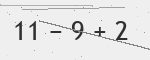
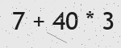
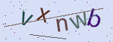
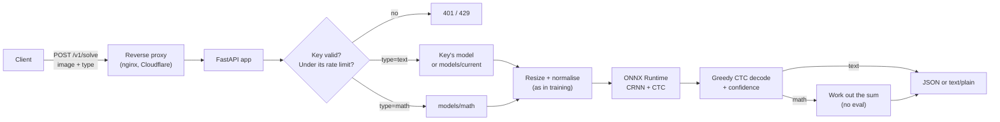

<div align="center">


# Captcha2Text

**Read text and math captchas with one HTTP request.**

Send the captcha image, get its text (or the answer to its sum) back in the same response,
with a confidence score. Self-hosted, CPU-only, a few milliseconds per image.

[](LICENSE)
[](pyproject.toml)
[](captcha2text/api.py)
[](captcha2text/model.py)
[](training/train_ctc.py)
[](https://captcha.silifton.com)

[Website](https://captcha.silifton.com) ·
[API docs](docs/API.md) ·
[Examples](#examples) ·
[Self-hosting](#self-hosting) ·
[Train a model](#models) ·
[Deploy guide](docs/DEPLOY.md)

</div>

```bash
curl -X POST https://captcha.silifton.com/v1/solve \
  -H "Authorization: Bearer $CAPTCHA2TEXT_KEY" \
  -F "image=@captcha.png" -F "type=math"
```

```json
{ "success": true, "text": "4+3-5", "answer": "2", "confidence": 0.9998, "processing_ms": 4 }
```

### What it reads

| Captcha | Sent with | API returns |
|:---:|:---:|---|
|  | `type=math` | `"text": "11-9+2"`, **`"answer": "4"`**, confidence 0.9997 |
|  | `type=math` | `"text": "7+40×3"`, **`"answer": "127"`** (multiplication first), confidence 0.9997 |
|  | – | **`"text": "hat"`**, confidence 0.9995 |
|  | – | **`"text": "vxnwb"`**, confidence 0.9898 |
|  | – | **`"text": "vuff"`**, confidence 0.9184 |
|  | – | `"text": "ndqv"` with confidence **0.2309**: wrong, and the low score says so. Load a new captcha. |

<sub>Real responses from the live models (`math-v1` for `type=math`, `ddddocr-beta-v1` for text) on
captchas generated with [training/synth.py](training/synth.py). Picked to show the range, including a
miss; measured accuracy is under [Models](#models).</sub>

---

## Contents

- [Features](#features)
- [Quick start](#quick-start)
- [Examples](#examples)
- [API at a glance](#api-at-a-glance)
- [How it works](#how-it-works)
- [Models](#models)
- [Self-hosting](#self-hosting)
- [Keys, admins and the admin panel](#keys-admins-and-the-admin-panel)
- [Project layout](#project-layout)
- [Development](#development)
- [Roadmap](#roadmap)
- [Acceptable use](#acceptable-use) · [Acknowledgements](#acknowledgements) · [License](#license)

## Features

- **One request, one answer.** Synchronous: no job ids, no polling.
- **Text and math captchas.** Text captchas return the characters; send `type=math` and
  sums like `4 + 3 - 5` come back worked out (`"answer": "2"`).
- **A confidence score with every answer**, so clients can reload a captcha instead of
  submitting a likely-wrong answer.
- **Model per API key.** Keep a general default model and give customers with an unusual
  captcha their own trained model, without changing their code.
- **Bring or train models.** Import [ddddocr](https://github.com/sml2h3/ddddocr)'s
  pretrained model, train a CRNN + CTC model on your own or synthetic captchas, and
  measure any model with the same code the API runs.
- **Small and fast.** ONNX Runtime on CPU: 2–15 ms per image in production, about 140 MB of
  RAM with two models loaded. No GPU needed to serve.
- **Batteries included.** Hashed API keys, per-key rate limits, a usage log, a landing page
  with an access-request form, an admin panel, and a strict Content-Security-Policy.
- **Simple to run.** One Python process with SQLite. systemd or Docker.

## Quick start

### Use the hosted API

1. Request a key at **https://captcha.silifton.com** (or create one in your admin panel).
2. Send a captcha:

```bash
export CAPTCHA2TEXT_KEY=c2t_live_...
curl -X POST https://captcha.silifton.com/v1/solve \
  -H "Authorization: Bearer $CAPTCHA2TEXT_KEY" \
  -F "image=@captcha.png"
```

```json
{ "success": true, "request_id": "req_01JD8X4M2Q7Z", "text": "kerry", "confidence": 0.98, "processing_ms": 6 }
```

### Run your own server

Needs Python 3.10+ and [uv](https://docs.astral.sh/uv/).

```bash
git clone https://github.com/zamansheikh/captcha2text.git && cd captcha2text
uv sync --extra dev --extra ddddocr

# a default model: ddddocr's pretrained general model, letters only
uv run python -m training.import_ddddocr --variant beta --allowed letters --lowercase --out models/ddddocr-beta-v1
ln -sfn ddddocr-beta-v1 models/current

uv run c2t-keys create --name "Local test"          # prints your key once
uv run uvicorn captcha2text.api:app --port 8000
```

Open http://127.0.0.1:8000 for the landing page and `/docs` for the API reference. For
math captchas, train or copy a math model into `models/math` ([how](#the-math-model)).

## Examples

All examples read the key from the `CAPTCHA2TEXT_KEY` environment variable. Call the API
from your server: a key shipped inside a web page or mobile app can be copied.

<details open>
<summary><b>cURL</b></summary>

```bash
# text captcha
curl -X POST https://captcha.silifton.com/v1/solve \
  -H "Authorization: Bearer $CAPTCHA2TEXT_KEY" \
  -F "image=@captcha.png"

# math captcha: the answer to the sum
curl -X POST https://captcha.silifton.com/v1/solve \
  -H "Authorization: Bearer $CAPTCHA2TEXT_KEY" \
  -F "image=@sum.png" -F "type=math"

# just the answer, as plain text
curl -X POST "https://captcha.silifton.com/v1/solve?type=math" \
  -H "Authorization: Bearer $CAPTCHA2TEXT_KEY" \
  -H "Accept: text/plain" \
  -F "image=@sum.png"
# 2

# base64 in JSON, for an image already in memory
curl -X POST https://captcha.silifton.com/v1/solve \
  -H "Authorization: Bearer $CAPTCHA2TEXT_KEY" \
  -H "Content-Type: application/json" \
  -d "{\"image\": \"$(base64 < captcha.png | tr -d '\n')\"}"
```

</details>

<details>
<summary><b>Python</b></summary>

```python
import os
import requests

API_URL = "https://captcha.silifton.com/v1/solve"
HEADERS = {"Authorization": f"Bearer {os.environ['CAPTCHA2TEXT_KEY']}"}


def solve(path: str, math: bool = False, min_confidence: float = 0.0) -> str | None:
    """Text of a captcha, or the answer to a math captcha. None means: load a new one."""
    with open(path, "rb") as f:
        resp = requests.post(API_URL, headers=HEADERS, files={"image": f},
                             data={"type": "math"} if math else None, timeout=15)
    data = resp.json()
    if not data.get("success"):
        if data["error"]["code"] in ("no_text_found", "invalid_expression"):
            return None
        raise RuntimeError(f"{data['error']['code']}: {data['error']['message']}")
    if data["confidence"] < min_confidence:
        return None
    return data["answer"] if math else data["text"]


print(solve("captcha.png"))           # kerry
print(solve("sum.png", math=True))    # 2
```

</details>

<details>
<summary><b>Node.js (18+)</b></summary>

```js
import { readFile } from "node:fs/promises";

async function solve(path, { math = false } = {}) {
  const form = new FormData();
  form.append("image", new Blob([await readFile(path)]), "captcha.png");
  if (math) form.append("type", "math");

  const res = await fetch("https://captcha.silifton.com/v1/solve", {
    method: "POST",
    headers: { Authorization: `Bearer ${process.env.CAPTCHA2TEXT_KEY}` },
    body: form,
    signal: AbortSignal.timeout(15000),
  });
  const data = await res.json();
  if (!data.success) throw new Error(`${data.error.code}: ${data.error.message}`);
  return math ? data.answer : data.text;
}

console.log(await solve("sum.png", { math: true })); // 2
```

</details>

<details>
<summary><b>PHP</b></summary>

```php
<?php
$ch = curl_init('https://captcha.silifton.com/v1/solve');
curl_setopt_array($ch, [
    CURLOPT_POST => true,
    CURLOPT_HTTPHEADER => ['Authorization: Bearer ' . getenv('CAPTCHA2TEXT_KEY')],
    CURLOPT_POSTFIELDS => ['image' => new CURLFile('sum.png', 'image/png'), 'type' => 'math'],
    CURLOPT_RETURNTRANSFER => true,
    CURLOPT_TIMEOUT => 15,
]);
$data = json_decode(curl_exec($ch), true);
curl_close($ch);

if (empty($data['success'])) {
    throw new RuntimeException($data['error']['code'] . ': ' . $data['error']['message']);
}
echo $data['answer']; // 2
```

</details>

<details>
<summary><b>Dart (server side)</b></summary>

```dart
import 'dart:convert';
import 'dart:io';
import 'package:http/http.dart' as http;

Future<String> solveMath(List<int> png) async {
  final request = http.MultipartRequest('POST', Uri.parse('https://captcha.silifton.com/v1/solve'))
    ..headers['Authorization'] = 'Bearer ${Platform.environment['CAPTCHA2TEXT_KEY']}'
    ..fields['type'] = 'math'
    ..files.add(http.MultipartFile.fromBytes('image', png, filename: 'captcha.png'));
  final response = await http.Response.fromStream(await request.send());
  final data = jsonDecode(response.body) as Map<String, dynamic>;
  if (data['success'] != true) throw Exception(data['error']['message']);
  return data['answer'] as String; // "2"
}
```

</details>

## API at a glance

| | |
|---|---|
| Base URL | `https://captcha.silifton.com/v1` |
| Auth | `Authorization: Bearer <API_KEY>` |
| Solve | `POST /v1/solve` with `image` (file upload, or base64 in JSON) and optional `type` (`text` or `math`) |
| Health | `GET /v1/health` (no key) |
| Images | PNG or JPEG, up to 2 MB |

| Response field | |
|---|---|
| `text` | what the image says (`kerry`, or `4+3-5` for a math captcha) |
| `answer` | math captchas only: the result of the sum (`"2"`) |
| `confidence` | 0 to 1; low means the answer is likely wrong |
| `processing_ms` | model time for this image |
| `request_id` | quote it when you report a problem |

Errors always come back as JSON with a stable `error.code`: `missing_api_key`,
`invalid_api_key`, `missing_image`, `invalid_image`, `invalid_body`, `invalid_type`,
`image_too_large`, `unsupported_media_type`, `no_text_found`, `invalid_expression`,
`rate_limited` (with `Retry-After`), `internal_error`, `service_unavailable`.

The full reference, with every field, limit and retry rule, is in **[docs/API.md](docs/API.md)**
and on the live site at [/docs](https://captcha.silifton.com/docs).

## How it works



- **Models are folders** (`model.onnx` + `model.json`). `model.json` says how to resize and
  normalise the image, how to read the output, and which characters are allowed.
  Preprocessing lives in one module that training imports too, so a model always sees
  images prepared the way it was trained.
- **Confidence** is the product of each output character's peak probability.
- **Math** is decoded like text (digits and `+ - ×`), then
  [mathexpr.py](captcha2text/mathexpr.py) parses the sum (multiplication first) without
  `eval`. Anything that isn't a complete sum is refused with `422 invalid_expression`.

## Models

| Model | Used for | How it was made | Measured |
|---|---|---|---|
| `ddddocr-beta-v1` | default (`models/current`) | ddddocr's pretrained model, letters only, lowercased | 95.1% on a "simple" synthetic style it never saw; 47.5% on heavily warped captchas |
| `math-v1` | `type=math` (`models/math`) | CRNN trained on 25,000 synthetic sums | 2,000 / 2,000 held-out synthetic sums; real sample `4 + 3 - 5` → `2` |
| `demo-synth-v1` | demo | CRNN trained on 30,000 warped synthetic captchas | 98.4% on its own style; 0% on a style it never saw |

The last row is the lesson behind the design: **a model is only as good as the captcha
style it was trained on.** Measure each new captcha style on a few hundred real, labelled
samples before relying on it; see [docs/MODEL-RISK.md](docs/MODEL-RISK.md).

### Model folders

Every folder in `models/` with a `model.json` is a model. Keys without a model use
`models/current`; a key with a model uses its folder; `type=math` requests use
`models/math`. The default model loads at start-up (a broken one stops the server); others
load on first use. Restart after changing a symlink.

```json
{
  "name": "acme-v1",
  "input": { "width": 128, "height": 48, "channels": 3, "layout": "NCHW" },
  "decoder": "ctc",
  "charset": "abcdefghijklmnopqrstuvwxyz0123456789"
}
```

All fields (auto width, LANCZOS resize, normalisation, time-major outputs, allowed
characters, lowercasing) are documented at the top of [model.py](captcha2text/model.py).

### Import ddddocr's pretrained model

```bash
uv sync --extra ddddocr
uv run python -m training.import_ddddocr --variant beta --allowed letters --lowercase --out models/ddddocr-beta-v1
uv run python -m training.import_ddddocr --variant beta --allowed letters+digits --out models/ddddocr-alnum-v1
```

`--allowed` rules out characters a captcha can't contain before the best one is picked; it
added 15–17 points on our warped test set. The server gives the same answers as the
ddddocr package (checked on 300 images for both of its models).

### Train your own (CRNN + CTC)

```bash
uv sync --extra train

# 1. data: real captchas labelled "<image name> <text>" per line, and/or synthetic ones
uv run python -m training.synth --out datasets/train --count 30000              # warped style
uv run python -m training.synth --out datasets/test --count 2000 --seed 2

# 2. train on the Apple GPU, a CUDA GPU or the CPU; exports model.onnx + model.json
uv run python -m training.train_ctc --data datasets/train/labels.txt --name acme-v1 --out runs/acme-v1

# 3. measure it exactly as the API runs it
uv run python -m training.evaluate --model runs/acme-v1/model --data datasets/test/labels.txt

# 4. install it and give a customer's key this model
cp -r runs/acme-v1/model models/acme-v1
uv run c2t-keys set-model <key id> acme-v1
```

`evaluate.py` prints exact-match accuracy, accuracy by length, and how many captchas you'd
answer (and get right) at each confidence cut-off:

```
Exact match: 1968/2000 = 98.40%   average 1.9 ms per image
If you only answer when confidence >= cut-off:
   cut-off  answered  right when answered
      0.00    100.0%               98.40%
      0.90     97.4%               99.38%
```

### The math model

```bash
uv run python -m training.synth --out datasets/math-train --style math --width 150 --count 25000 --seed 11
uv run python -m training.synth --out datasets/math-test  --style math --width 150 --count 2000  --seed 12
uv run python -m training.train_ctc --data datasets/math-train/labels.txt --name math-v1 --out runs/math-v1 --epochs 14
cp -r runs/math-v1/model models/math-v1 && ln -sfn math-v1 models/math
```

About 8 minutes on an Apple M5. The math style draws 2–3 numbers with `+ - ×` in plain
sans-serif fonts on light grey, with thin lines and specks.

### Export the original TensorFlow model

[captcha_reader.ipynb](captcha_reader.ipynb) trains an attention model (90.7% on its
dataset). In that notebook's environment, with its checkpoint and dataset:

```bash
pip install tf2onnx onnxruntime
python training/export_attention.py --annotations words_captcha/spec_train_val.txt \
    --checkpoint checkpoints/train --out models/words-v1 --eval 2000
```

## Self-hosting

| | |
|---|---|
| Runtime | Python 3.10+, one process, SQLite; no GPU |
| Memory | about 140 MB with two models loaded |
| Proxy | any HTTPS reverse proxy; allow 4 MB bodies (a 2 MB image as base64 is ~2.7 MB) |

```bash
docker compose up -d --build                         # API on 127.0.0.1:7030
docker compose exec api c2t-keys admin-create admin  # prints the admin password once
```

Without Docker, run it under systemd with a virtualenv. The step-by-step guide for both,
including the live server, is in **[docs/DEPLOY.md](docs/DEPLOY.md)**.

### Configuration

All optional, read from the environment.

| Variable | Default | Meaning |
|---|---|---|
| `C2T_MODELS_DIR` | `models` | folder of model folders |
| `C2T_DEFAULT_MODEL` | `current` | model for keys that have no model of their own |
| `C2T_MATH_MODEL` | `math` | model for requests with `type=math` |
| `C2T_DB_PATH` | `data/captcha2text.db` | SQLite file: keys, admins, usage, access requests |
| `C2T_MAX_IMAGE_BYTES` | `2097152` | largest image accepted (2 MB) |
| `C2T_MAX_IMAGE_PIXELS` | `16777216` | largest decoded image (4096 × 4096) |
| `C2T_DEFAULT_RPM` | `60` | requests per minute for new keys |
| `C2T_ORT_THREADS` | `0` (auto) | CPU threads ONNX Runtime uses per image |

Run one process: requests run on threads, and the rate limiter lives in memory.

## Keys, admins and the admin panel

The server serves three pages next to the API:

| Page | |
|---|---|
| `/` | landing page with a **Request an API key** form (5 per hour per visitor, bot trap) |
| `/docs` | the API reference |
| `/admin` | admin panel: usage overview and 14-day chart; create keys (shown once), change their limit or model, revoke them; turn access requests into keys; see the model folders |

Everything is also available from the command line:

```bash
c2t-keys create --name "Acme Ltd" --rpm 60      # prints the key once; only a hash is stored
c2t-keys create --name "Acme Ltd" --model acme-v1
c2t-keys set-model 3 acme-v1                   # or "default"
c2t-keys set-rpm 3 120
c2t-keys revoke 3                              # stops working on the next request
c2t-keys list
c2t-keys usage --days 30

c2t-keys admin-create alice                    # admin panel login, password printed once
c2t-keys admin-password alice                  # new password, signs alice out everywhere
c2t-keys admin-list
```

**Security.** API keys and admin passwords are stored as hashes (SHA-256 and scrypt).
Admin sessions are HttpOnly, SameSite=Strict cookies that last 12 hours; five wrong
passwords lock a login for 15 minutes, and each IP gets 20 attempts per 15 minutes. Admin
changes must be same-site JSON. Every page sends a Content-Security-Policy that only allows
its own inline script, by hash.

## Project layout

```
captcha2text/          the API server
├── api.py             /v1 endpoints; assembles the app
├── admin.py           admin logins, sessions, access requests, /admin/api
├── web.py             serves web/ with a strict Content-Security-Policy
├── web/               index.html (landing), docs.html (API docs), admin.html (panel)
├── model.py           model folders, preprocessing settings, CTC decoding, per-key choice
├── mathexpr.py        works out sums for type=math
├── images.py          decoding and preprocessing, shared with training
├── keys.py            API keys + usage log (SQLite) and the c2t-keys command
├── ratelimit.py       per-key token bucket, sliding-window limiter
└── config.py, errors.py
training/              makes models (not needed on the server)
├── synth.py           synthetic captchas: warped, simple and math styles
├── train_ctc.py       CRNN + CTC trainer with ONNX export
├── evaluate.py        accuracy and confidence cut-offs, through the server's code
├── import_ddddocr.py  ddddocr's pretrained model as a model folder
└── export_attention.py  the notebook's TensorFlow model as ONNX
tests/                 pytest suite
deploy/systemd/        systemd unit, nginx site and deploy script (see docs/DEPLOY.md)
docs/                  API.md, DEPLOY.md, MODEL-RISK.md
models/                model folders (not in git)
```

## Development

```bash
uv sync --extra dev --extra train --extra ddddocr
uv run pytest                                   # 89 tests, about 2 seconds
uv run uvicorn captcha2text.api:app --reload    # serves the pages too
```

- Tests use a fake model for the HTTP layer and tiny hand-built ONNX models for the
  decoders, so they need no trained model files.
- `docs/API.md` and `captcha2text/web/docs.html` describe the same API; change both.
- Keep changes covered by tests, and run `training/evaluate.py` before replacing a model.

## Roadmap

- [x] Text captchas with per-key models
- [x] Math captchas (`type=math`)
- [x] Admin panel, landing page, access requests
- [ ] `POST /v1/report` so clients can flag answers the site rejected
- [ ] Measure `math-v1` on a few hundred real captchas per site
- [ ] Hide math models from the key's model list in the admin panel
- [ ] Usage export per key for billing

## Acceptable use

Use Captcha2Text only on captchas you own or are allowed to solve: testing your own site,
accessibility tools, or automating your own accounts where that's permitted. It does not
handle reCAPTCHA, hCaptcha, Turnstile, image puzzles or audio captchas.

## Acknowledgements

- [ddddocr](https://github.com/sml2h3/ddddocr) (MIT) for the pretrained general model;
  its licence ships with every imported model folder.
- [captcha](https://github.com/lepture/captcha) (BSD-3-Clause) for synthetic training data.
- [FastAPI](https://fastapi.tiangolo.com), [ONNX Runtime](https://onnxruntime.ai),
  [PyTorch](https://pytorch.org), [Pillow](https://python-pillow.org) and [NumPy](https://numpy.org).

## License

Captcha2Text is licensed under the [Apache License, Version 2.0](LICENSE).
Copyright 2026 Silifton; see [NOTICE](NOTICE).

Models imported from ddddocr keep their MIT licence (`LICENSE-ddddocr.txt` in each
imported model folder).
